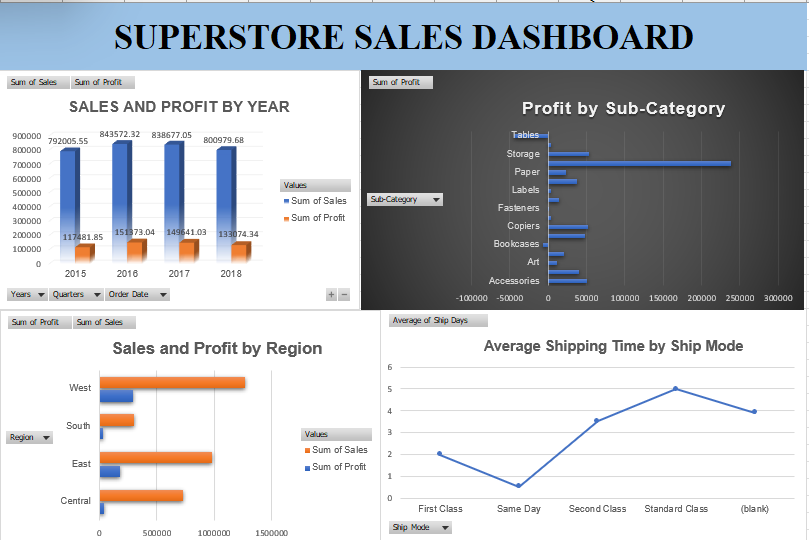

# Superstore Sales Analysis with Excel

## 1. Project Overview

This personal project was developed to strengthen my practical Microsoft Excel skills through a retail sales dataset.

The project focuses on data preparation, PivotTables, data analysis, chart creation, and dashboard design. By exploring business-related questions, I practiced using Excel to summarize data, compare key metrics, identify trends, and communicate findings visually.

## 2. Objectives

- Practice data cleaning and preparation in Excel.
- Use PivotTables to summarize and analyze retail data.
- Compare Sales, Profit, Quantity, Discount, and shipping-related metrics.
- Create charts to present analysis results.
- Build a dashboard to summarize key findings.

## 3. Tools Used

- **Microsoft Excel** — Data preparation, PivotTables, charts, and dashboard creation.

## 4. Dataset Overview

The dataset contains approximately 10,000 records and 15 columns related to retail transactions, including:

- Order Date and Ship Date
- Customer ID and Segment
- Region, Category, and Sub-Category
- Sales, Quantity, Discount, and Profit
- Ship Mode

## 5. Project Workflow

1. **Data Preparation:** Inspected the dataset, reviewed missing values, converted date formats, and calculated shipping time.
2. **Data Analysis:** Used PivotTables to summarize data and answer seven business-related questions.
3. **Visualization:** Created charts to compare trends and performance across different dimensions.
4. **Dashboard:** Organized selected charts into a dashboard to present the main findings.

## 6. Analysis Questions

The project explores the following questions:

1. How did Sales and Profit change from 2015 to 2018?
2. Which product sub-categories had high quantities but low or negative Profit?
3. How did average Profit vary across different Discount levels?
4. Which customer Segment generated the highest Sales and Profit?
5. How did Sales and Profit compare across Regions?
6. What was the average time from order placement to shipment for each Ship Mode?
7. Which Ship Mode appeared most frequently in the dataset?

## 7. Key Findings

- Sales and Profit increased through 2016, then declined in the following years.
- Some product sub-categories showed weak or negative profitability.
- Average Profit was negative at Discount levels of 30%, 40%, and 50% in the analyzed dataset.
- Consumer generated the highest Sales and Profit among the main customer segments.
- West recorded the highest Sales and Profit among the regions.
- Standard Class was the most frequently recorded Ship Mode, accounting for 58.82% of transaction records.

These findings describe patterns observed in the dataset and do not, by themselves, establish the causes behind business performance.

## 8. Dashboard Preview

<!-- Add your dashboard screenshot here after uploading it to the images folder. -->

## 9. Project Files

| File | Description |
|---|---|
| `Superstore_Sales_Analysis.xlsx` | Excel workbook containing the prepared data, analysis sheets, dashboard, and insights. |
| `Superstore_Sales_Analysis_Report.docx` | Report describing the project objectives, workflow, analysis, and learning outcomes. |
| `README.md` | Project overview and summary. |
| `img/Dashboard.png` | Dashboard screenshot, if included. |

## 10. Learning Outcomes

Through this project, I gained practical experience in preparing data, using PivotTables, summarizing metrics, creating charts, and designing a dashboard in Excel.

This project also provided a foundation for further developing my data analysis skills through additional tools and projects.